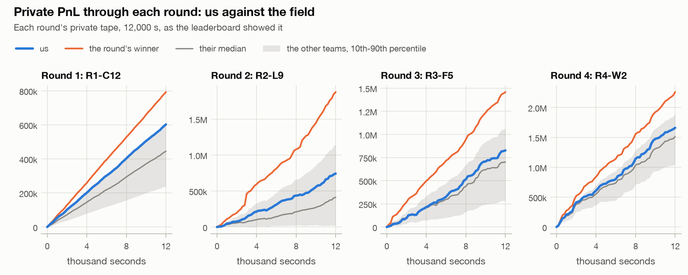
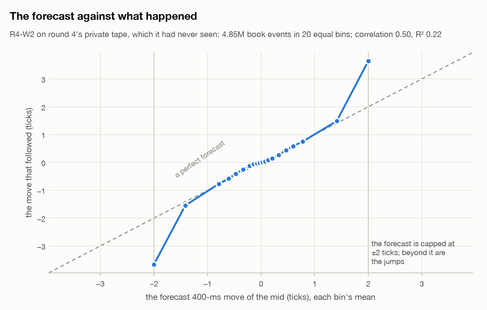
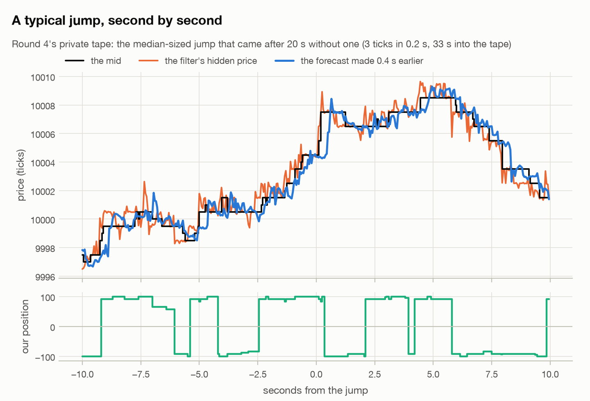

# ThatsMyQuant at the Qminers Algo Trade Arena 2026

Our team's repository from the [Qminers](https://www.qminers.com/) Algo Trade Arena (7-8 Nov 2026, MFF UK, Prague):
a 24-hour algorithmic trading hackathon in four 5-hour rounds. In each round a team uploaded a Python bot, which the
organisers' exchange simulator ran on a validation tape at once and on a private tape after the deadline; the private
PnL decided the round, and the four rounds combined (0.8·z1 + z2 + z3 + 1.2·z4) decided the event.

**We finished 16th of 61** (8th, 22nd, 17th and 17th by round) with one model family that we rebuilt every round: an
online ridge regression that forecasts the mid price 400 ms ahead from the order book and learns on the tape as it
plays. [`RESULTS.md`](RESULTS.md) has the standings, each round's final bot and every upload;
[`docs/postmortem.md`](docs/postmortem.md) what the market turned out to be.

| Round | Final bot | Validation | Private | Rank |
|---|---|---:|---:|---|
| 1 | R1-C12: market maker on the forecast | 622,921 | 602,527 | 8th of 61 |
| 2 | R2-L9: pure forecast taker, robust fit | 873,719 | 742,470 | 22nd of 59 |
| 3 | R3-F5: the taker + a filter of the hidden price + a jump-aware bar | 888,195 | 827,253 | 17th of 53 |
| 4 | R4-W2: R3-F5 with its ridge warm-started from the public tape | 1,754,574 | 1,659,546 | 17th of 52 |

<picture>
  <source media="(prefers-color-scheme: dark)" srcset="docs/img/pnl_vs_field-dark.png">
  
</picture>

Every team's PnL rose in a nearly straight line; ours finished above the field's median in every round, while the
winners (one team took rounds 2-4) pulled steadily away, in round 2 with a single step of about 148k at a jump.

## The model, round by round

- **Round 1: a market maker.** 29 order-book features (fresh quote prices, one-second flow groups, imbalance), the
  forecast learned online; it quotes up to 200 lots at the touch and steps a tick back when the forecast is against
  that side. Replacements go out while cancels are in flight, with an IOC hedge back inside the 100-lot limit.
- **Round 2: the same forecast, used to take.** The tape moved twice as often per lot and every maker lost, so the
  bot stopped quoting and sends an IOC order only when the forecast beats half the spread by 0.15 ticks. The final,
  with a Huber-robust fit and impact features, is Přemysl's improvement of our pure taker.
- **Round 3: a filter of the hidden price.** New orders land around a latent price that the mid only follows; a
  Bayesian filter of it from where they land adds three features and was worth +20% on the validation tape. A
  higher take bar away from jumps came on top.
- **Round 4: a warm start.** Round 3's curves showed our first 1,000 s was the weakest of the top 17; the final
  starts its ridge from the statistics it learned on round 4's public tape.

### How good the forecast was

On round 4's private tape (rebuilt from the server's logs; our Rust twin of the final makes 1,656,080 on it against
the server's 1,659,546), the final bot's forecast of the next 400 ms correlates 0.50 with the move that followed
(R² 0.22) over 4.85 million book events, a tape it had never seen. Binned, it sits on the diagonal until its ±2-tick
cap, beyond which are the jumps:

<picture>
  <source media="(prefers-color-scheme: dark)" srcset="docs/img/forecast_calibration-dark.png">
  
</picture>

Second by second, around a typical jump (the median-sized one after a quiet spell). The forecast is drawn at the
time it was made for, so where the blue line moves before the mid, it saw the move coming; the jump at 0 itself
came without warning, and the forecast caught up 0.3 s later:

<picture>
  <source media="(prefers-color-scheme: dark)" srcset="docs/img/jump_window-dark.png">
  
</picture>

The charts come from `python -m experiments.day.readme_charts` (its docstring has the steps).

Every candidate is in [`python/bots/qminers/candidates/`](python/bots/qminers/candidates/), each file's docstring
holding the notes of the bots it builds on; each round's reasoning is in `data/arena/round<N>/HANDOVER.md`, and every
idea we tested, kept or dropped, with its numbers, in [`IDEAS.md`](IDEAS.md).

## Rust: the exchange simulator, to the cent

[`rust/arena_sim/`](rust/arena_sim/) is a port of the organisers' Python exchange simulator that gives the same
`result.json` and `pnl.csv` byte for byte, with Rust versions of our strategies whose runs match the Python bot
files to the unit. Measured on 9 Nov, one core each, the final bot on round 4's public tape (2.4 million events):

| Engine | Time | PnL | Fills |
|---|---:|---:|---:|
| The organisers' Python simulator, `r4_W2_warm10k.py` | 156 s | 1,029,781 | 42,139 |
| `arena_sim`, R4-W2 as `ridge_maker` | 21 s | 1,029,781 | 42,139 |

That is the slowest case, a 39-feature ridge refitted every second; the simpler strategies ran 50-90 times faster,
so a round's grid ran hundreds of cells instead of five. From
round 3 on the rule was "Rust first": every candidate chosen in Rust, then checked once in Python before its upload
(`python -m arena.qsim_rust`, `python -m experiments.day.family_rust`; [`rust/README.md`](rust/README.md)).

## What is here

| Path | What it is |
|---|---|
| [`RESULTS.md`](RESULTS.md) | Standings, the final bots and their lineage, every upload, what the field's curves showed |
| [`docs/postmortem.md`](docs/postmortem.md) | What the market was (a generator with a hidden price), why the prep did not transfer, what we would do differently |
| `data/arena/round<N>/` | Each round: `HANDOVER.md`, `CANDIDATES.md`, the leaderboard, the server's result folders (every upload and private run) |
| `data/arena/gen/` | The tape generator we recovered: fitted parameters per round, its checks against the server's scores |
| `python/bots/qminers/` | Our bot template (`ArenaBot`), its strategy families and every round's candidates |
| `python/experiments/day/` | The round tools: `round_start`, `family_rust`, `latent_filter`, `gen_identify`, `tape_gen`, `warm_embed`, ... ([`python/experiments/README.md`](python/experiments/README.md)) |
| `python/arena/` | Our engine and CLIs (`qgrid` on the organisers' simulator, `qsim_rust` on its Rust port, `validate` for the sandbox's rules); built before the event on Prosperity data, so it also speaks that format |
| `rust/arena_sim/` | The Rust port of the exchange simulator and our strategies in it |
| `codex_repo/` | Our second repository (a Codex session's, started from the clean starter) with Přemysl's research branch merged, with their history |
| [`docs/tools.md`](docs/tools.md) | How to run the tools; [`docs/day/`](docs/day/) the day's playbook as it was used; [`docs/architecture.md`](docs/architecture.md) how the engine fits together |
| `simulator/`, `explorer/`, `strategies/`, `STARTER.md` | The organisers' starter (their exchange simulator, backtest explorer, examples and README) as they gave it to the teams |

## Running it

```sh
uv sync                          # Python 3.13
uv run pytest                    # the round tools' tests
cargo build --release -p arena_sim --manifest-path rust/Cargo.toml
```

The round tapes are the organisers' and are not included; with a round's public tape at
`data/arena/round4/round4_public.csv`, `uv run exchange-simulator --strategy python/bots/qminers/candidates/r4_W2_warm10k.py
--backtest data/arena/round4/round4_public.csv --log-dir logs/w2 --no-logs` runs round 4's final bot on it
(1,029,781 on the public tape), and `uv run python -m experiments.day.family_rust data/arena/round4/round4_public.csv`
ranks the round-3 bots in Rust in about two minutes.

## How we worked

Two people and a lot of AI. Most of the code and analysis was written by Claude Code agents (up to five at a time,
each in its own git worktree, merged back as they finished); a Codex session worked in a second repository from the
organisers' clean starter (`codex_repo/`), and Přemysl ran his own research branch there. The organisers required a
research repository with a commit at least every 30 minutes, so the history shows the 24 hours as they happened:
every candidate, every upload and every dropped idea. [`TEAM.txt`](TEAM.txt) lists the tools; [`docs/day/`](docs/day/)
holds the runbook and the prompts the agents ran on.

The month of preparation before the event, built on IMC Prosperity data as a stand-in for the unknown API (a
backtesting engine with a Rust twin, a zoo of bots written by different LLMs, a wiki of the market-making
literature), is in a separate prep repository.

## Credits

Team ThatsMyQuant: Jakub Kučera and Přemysl Pilař. The Arena, its exchange simulator, explorer, sample data and
round tapes are by Qminers; their starter is included as they distributed it to the teams and is not ours to
license. Other teams appear in this repository as "Team N", N their place in the overall standings.
