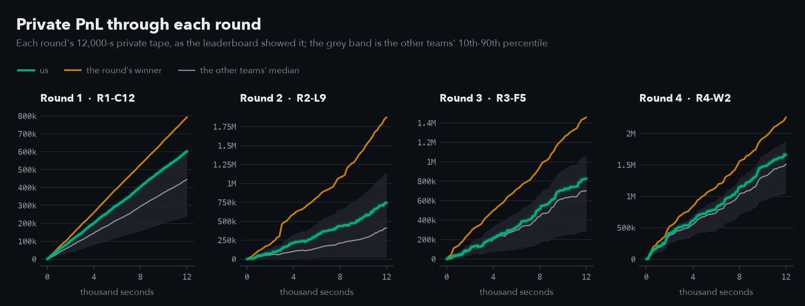
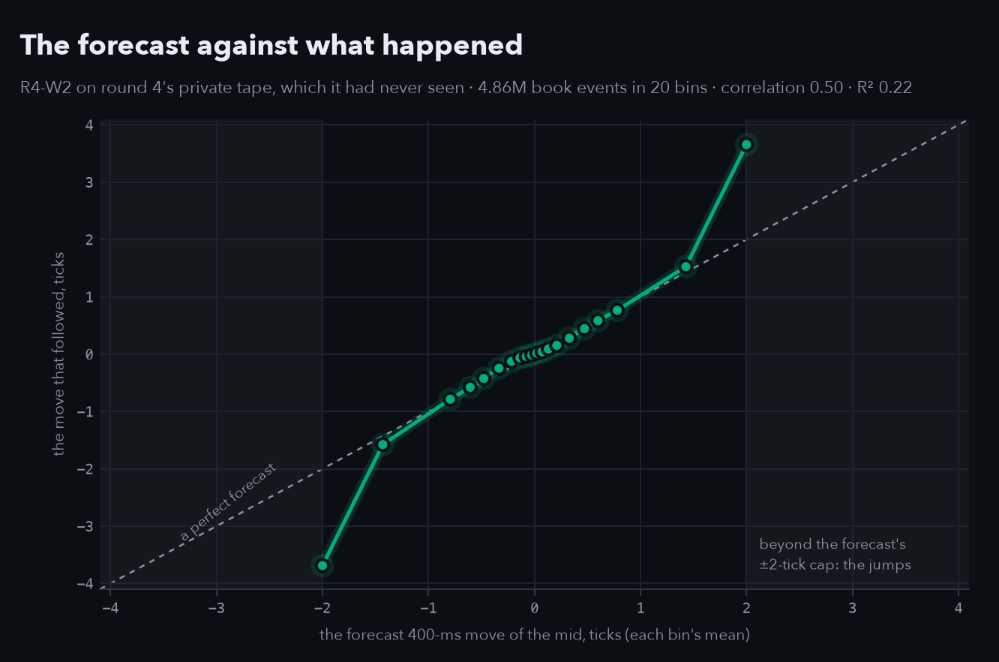
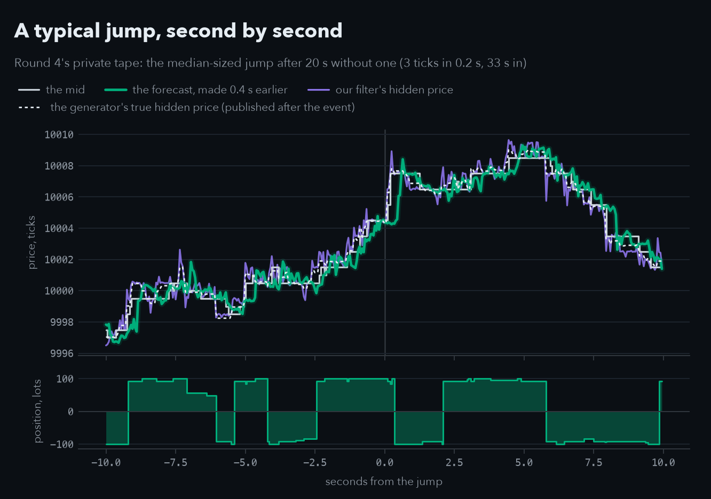
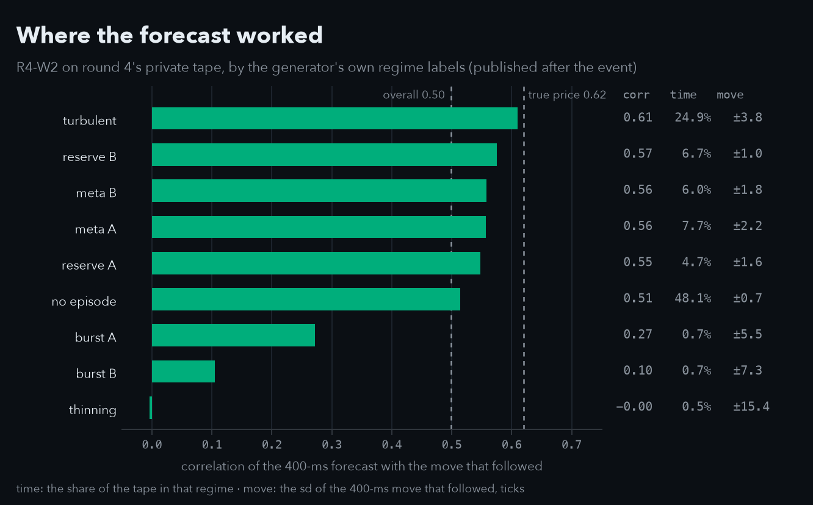
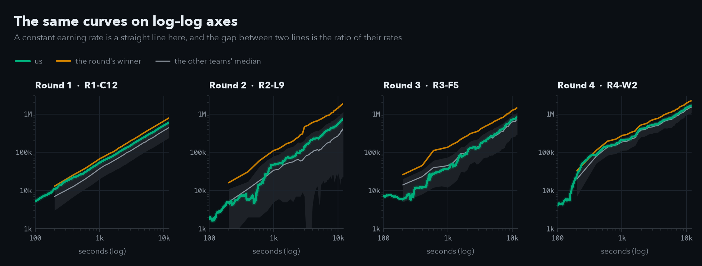

# ThatsMyQuant at the Qminers Algo Trade Arena 2026

**16th of 61** in a 24-hour algorithmic trading hackathon, with one online-learning forecast of the order book that
we rebuilt every round, and a Rust port of the exchange simulator that matches the original to the cent.

The [Qminers](https://www.qminers.com/) Algo Trade Arena (7-8 Nov 2026, MFF UK, Prague) ran four 5-hour rounds. In
each, a team uploaded one Python bot; the organisers' simulator ran it on a validation tape at once and on a private
tape after the deadline, and the private PnL decided the round. The rounds combined as 0.8·z1 + z2 + z3 + 1.2·z4.

## Results

| Round | Final bot | Validation | Private | Rank |
|---|---|---:|---:|---|
| 1 | R1-C12: market maker on the forecast | 622,921 | 602,527 | 8th of 61 |
| 2 | R2-L9: pure taker, robust fit | 873,719 | 742,470 | 22nd of 59 |
| 3 | R3-F5: taker + a filter of the hidden price | 888,195 | 827,253 | 17th of 53 |
| 4 | R4-W2: R3-F5, warm-started | 1,754,574 | 1,659,546 | 17th of 52 |



Every team earned in a nearly straight line. Ours finished above the field's median in every round; the winners
(one team took rounds 2-4) pulled steadily away, in round 2 with a single step of about 148k at a price jump.
[`RESULTS.md`](RESULTS.md) has the overall standings, the lineage of each final bot and every upload.

## How the bot works

```
order book events ─► 29-39 features ───► online ridge regression ─► forecast of the mid ─► act
                     flow, imbalance,     refitted every second      400 ms ahead            round 1: quote at the touch
                     quote placement,     on labels that have                                rounds 2-4: take (IOC) when the
                     impact; from round   matured (Huber loss                                forecast beats half the spread,
                     3 a filter of the    from round 2)                                      always inside the 100-lot limit
                     hidden price
```

- **Round 1, a market maker.** The forecast decides where to quote: at the touch, a tick back on the side it is
  against. Replacements go out while cancels are still in flight, with an IOC hedge back inside the limit.
- **Round 2, a taker.** The tape moved twice as often per lot traded and every maker lost money, so the bot stopped
  quoting and only takes when the forecast clears the spread. The final, with a robust fit and impact features, is
  Přemysl's improvement of our pure taker.
- **Round 3, a filter of the hidden price.** New orders land around a latent price that the mid only follows; a
  Bayesian filter of it from where they land added three features and **+20% on the validation tape**, the
  largest gain of the event.
- **Round 4, a warm start.** The ridge starts from what it learned on the round's public tape instead of from zero.

Each candidate is a single file in [`python/bots/qminers/candidates/`](python/bots/qminers/candidates/) (115 of them,
the four finals named above), its docstring holding the notes of the bots it builds on. Every idea we tested, kept or
dropped, is in [`IDEAS.md`](IDEAS.md) with its command and numbers; each round's reasoning is in
`data/arena/round<N>/HANDOVER.md`.

## Did the forecast work?

After the event the organisers published the private tapes, together with the generator's own hidden fair price and
its regime labels, so the forecast can be checked against the truth. On round 4's private tape, which the final had
never seen, its 400-ms forecast correlates 0.50 with the move that followed (R² 0.22, 4.86 million book events).
Binned, it sits on the diagonal until its ±2-tick cap; beyond the cap are the price jumps.



Second by second, around a typical jump. The forecast is drawn at the time it was made *for*, so where the green line
moves before the mid, the bot saw the move coming. The jump at 0 itself came without warning; the forecast caught up
0.3 s later, and the position below flips with it. The dashed line is the generator's true hidden price: our filter's
estimate of it (violet) was on average 0.43 ticks away from it, against 0.65 for the mid.



Where it worked, by the generator's own regimes: through the calm, turbulent, reserve and meta stretches, 98% of the
tape, the forecast holds at 0.51-0.61, but in the short burst and thinning episodes (2% of the tape, moves of ±5.5 to
±15 ticks against ±0.7 to ±3.8 elsewhere) it falls to 0.27, 0.10 and nothing. Knowing the true hidden price would
have reached 0.62 overall, a ceiling we came within 0.12 of; the winners' jump bets suggest those episodes are where
much of the rest of the money was.



## The first minutes

On log-log axes a constant earning rate is a straight line, and the gap between two lines is the ratio of their
rates, so the start of each round becomes visible. In round 3 our ridge started from nothing and stayed below the
field's median for the first 2,000 s; in round 4 it started warm and was above the median from the first minutes,
though round 4's opening was also its richest stretch for everyone (on the validation tape the warm start alone was
worth only +1.8k). Where the grey band drops to the floor, the bottom tenth of the field was near zero.



## Rust: the simulator, to the cent

[`rust/arena_sim/`](rust/arena_sim/) ports the organisers' Python exchange simulator and gives the same `result.json`
and `pnl.csv` byte for byte, with Rust versions of our strategies whose runs match the Python bot files to the unit.
Measured on one core, the final bot on round 4's public tape (2.4 million events):

| Engine | Time | PnL | Fills |
|---|---:|---:|---:|
| The organisers' Python simulator, `r4_W2_warm10k.py` | 156 s | 1,029,781 | 42,139 |
| `arena_sim`, the same bot as `ridge_maker` | 21 s | 1,029,781 | 42,139 |

That is the slowest case, a 39-feature ridge refitted every second; simpler strategies ran 50-90 times faster. It
turned a round's grid search from five cells into hundreds. On the private tapes the organisers published after the
event, the port reproduces the server's scores exactly:

| Final | Private PnL, server | Our run on the published tape | Fills |
|---|---:|---:|---:|
| R1-C12 (their Python simulator) | 602,526.53 | 602,526.53 | 20,662 |
| R2-L9 (`arena_sim`) | 742,470 | 742,470 | 6,979 |
| R3-F5 (`arena_sim`) | 827,253 | 827,253 | 120,505 |
| R4-W2 (`arena_sim`) | 1,659,546 | 1,659,546 | 94,026 |

From round 3 on, every candidate was chosen in Rust and checked once in Python before its upload
([`rust/README.md`](rust/README.md)).

## What is where

```
RESULTS.md               standings, the final bots and their lineage, every upload
IDEAS.md                 every idea tested during the event, with its command and numbers
python/
  bots/qminers/          the bot template (ArenaBot), its strategy families, candidates/round0..round4/
  experiments/           the round tools by theme: rounds/ tape/ generator/ filter/ maker/ taker/ audits/
  arena/                 our engine and command-line tools: qgrid, qsim_rust, validate
rust/arena_sim/          the Rust port of the exchange simulator, and our strategies in it
data/arena/
  round1..round4/        each round's record: HANDOVER.md, CANDIDATES.md, leaderboard, the server's results
  gen/                   the tape generator we recovered from the data: fitted parameters, checks
  runs/                  the event's run outputs: grid tables, run summaries, the policy search
docs/                    tools.md, postmortem.md, day/ (the playbook as used), research/, img/
codex_repo/              our second repository, a Codex session's, with Přemysl's research branch
third_party/
  qminers-starter/       the organisers' starter: their simulator, explorer, examples and README
```

Start with [`RESULTS.md`](RESULTS.md), the [candidates' index](python/bots/qminers/candidates/README.md), the
[round tools' index](python/experiments/README.md) and [`docs/tools.md`](docs/tools.md) for the commands.

## Running it

```sh
uv sync && uv run pytest                                              # Python 3.13
cargo build --release -p arena_sim --manifest-path rust/Cargo.toml   # the Rust simulator
```

The round tapes are the organisers' and are not included. With a round's public tape at
`data/arena/round4/round4_public.csv`:

```sh
uv run exchange-simulator --strategy python/bots/qminers/candidates/round4/r4_W2_warm10k.py \
    --backtest data/arena/round4/round4_public.csv --log-dir logs/w2 --no-logs    # 1,029,781
uv run python -m experiments.rounds.family_rust data/arena/round4/round4_public.csv  # the round-3 bots in Rust, ~2 min
```

## How we worked

Two people and a lot of AI. Most of the code and analysis was written by Claude Code agents, up to five at a time,
each in its own git worktree and merged back as it finished; a Codex session worked in a second repository from the
organisers' clean starter (`codex_repo/`), where Přemysl also ran his own research branch. The organisers required a
commit at least every 30 minutes, so the history shows the 24 hours as they happened: every candidate, every upload,
every dropped idea. [`docs/day/`](docs/day/) holds the runbook and the prompts the agents worked from.

The month of preparation before the event, built on IMC Prosperity data as a stand-in for the unknown API, is in
[qminers-arena-prep](https://github.com/jakub-kucera/qminers-arena-prep). What the Arena's market turned out to be,
and what we would do differently, is in [`docs/postmortem.md`](docs/postmortem.md).

## Credits and licence

Team ThatsMyQuant: Jakub Kučera and Přemysl Pilař. Jakub ran the event: he set each round's direction, made all 40
uploads of rounds 1-4 and worked rounds 3 and 4 alone. Přemysl joined for parts of rounds 1 and 2. His research
branch in the second repository covered the round-1 models, the economics of the position penalty and a round-2
composite, and his improved taker became round 2's final bot (R2-L9).

Our code and documents are under the MIT licence ([`LICENSE`](LICENSE)).

The Arena, its exchange simulator, backtest explorer, sample data and round tapes are by Qminers. Their starter
(`third_party/qminers-starter/`: the simulator, explorer, examples and their README; `data/sample.csv.gz`; and the
copies of these in `codex_repo/`, with `codex_repo/docs/ORGANIZER_GUIDE.md`) is included as they distributed it to the teams and is not covered
by our licence; the round tapes are not included. `rust/arena_sim/` is our port of their simulator. The HTML reports
in `codex_repo/research/` embed third-party charting code under its own licence. Other teams appear as "Team N", N
their place in the overall standings. The charts come from `python -m experiments.rounds.readme_charts`.
